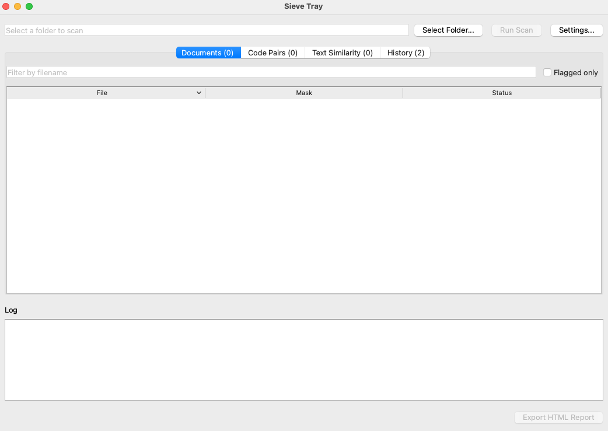
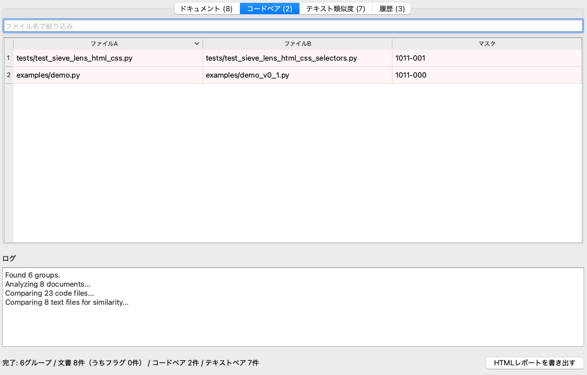
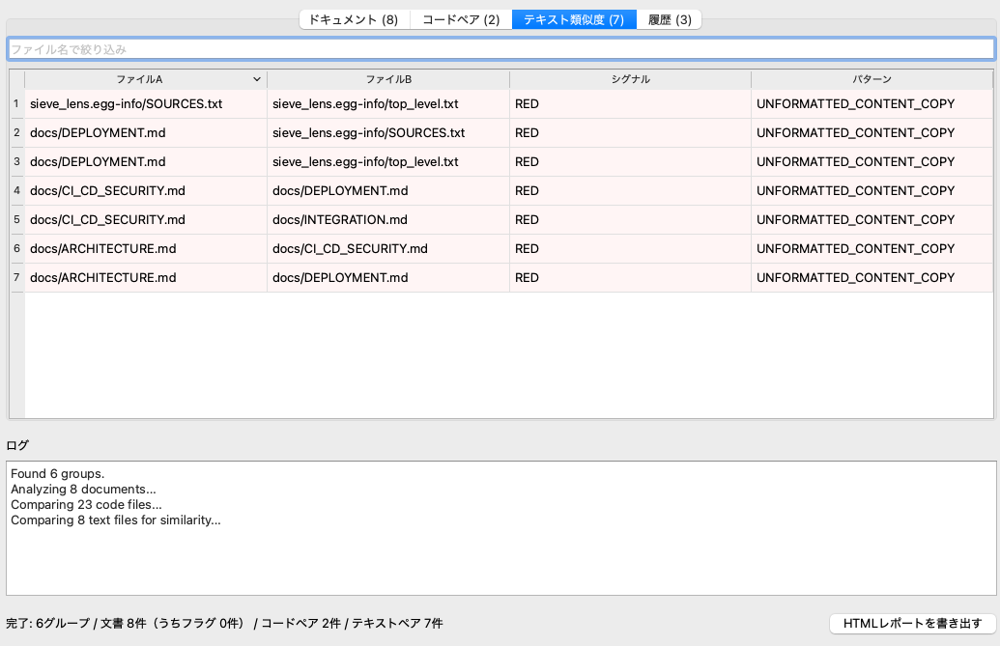

[English](README.md) | **日本語**

# Sieve Tray v0.9.0

**汎用観測ツール — Sieveシリーズのデスクトップフロントエンド**

> [Sieve Lens](https://github.com/neguseatama/sieve-lens)の不可視コンテンツ観測、
> [Sieve Scope](https://github.com/neguseatama/sieve-scope)のコード類似度検知、
> [Sieve Referee](https://github.com/neguseatama/sieve-referee)のテキストパラフレーズ検知 —
> そしてv0.8.0で新たに追加されたSieve Refereeの量化子監査レーン — を、
> 1つのデスクトップアプリに統合しました。提出物のフォルダを指定するだけで、
> 不可視のコンテンツや隠されたプロンプトを含む文書、構造的に疑わしく似ているコードペア、
> 言い換え・流用の疑いがあるテキストペア、根拠のない全称主張（ハルシネーション候補）を
> 含む文を、一度にまとめて検出、報告します。

[](https://github.com/neguseatama/sieve-tray/actions/workflows/test.yml)
[](https://github.com/neguseatama/sieve-tray/actions/workflows/release.yml)
[](https://opensource.org/licenses/MIT)
[](https://www.python.org/)

---

## 💡 コンセプト

[Sieve Lens](https://github.com/neguseatama/sieve-lens)は「この文書には、人間には
見えないがパーサには読める何かが含まれていないか」を、
[Sieve Scope](https://github.com/neguseatama/sieve-scope)は「この2つのソースコードは、
偶然とは思えないほどロジックが似ていないか」を、
[Sieve Referee](https://github.com/neguseatama/sieve-referee)は「このテキストは、
あちらのテキストを言い換えただけではないか」を、それぞれ観測します。いずれも
Sieveシリーズらしい、外部依存ゼロ・決定論的な観測エンジンですが、提出物フォルダを
実際にチェックするには、これらを別々に走らせ、結果を自分で突き合わせる必要が
ありました。

**Sieve Tray**はその手間をなくします。1提出者につき1サブフォルダ、という構造の
フォルダを指定するだけで、ファイルごとに適切なエンジンへ自動的に振り分けます
（文書はSieve Lensへ、`.py`ファイルはSieve Scopeのペア比較へ、プレーンテキスト
（`.txt`/`.md`）はさらにSieve Refereeのペア比較**と量化子監査レーン**へ
（v0.8.0で追加・Sieve Referee >=1.3.0 が必要）。結果は1つのウィンドウに
まとまり、履歴が残るので再スキャンは不要、さらにどの観測軸が反応し、その根拠が
何だったかまで詳細表示で確認できます。単なる「白黒の判定」ではなく、エンジンが
実際に観測した事実だけを提示します。

> 他のSieveシリーズ同様、これは**観測ツールであって、判定ツールではありません**。
> フラグが立つことは「人間が確認すべき」という意味であり、「不正が確定した」という
> 意味ではありません。

---

## 🧩 Sieve シリーズ

Sieve は、決定的・ゼロ依存・完全ローカルという共通の設計原則を共有する
エンジン群です。各エンジンが 1 つのリスクの観測または排除を担い、
相互に接続します:

| パッケージ | 役割 | 接続 |
|---------|------|-------------|
| [sieve-core-engine](https://github.com/neguseatama/sieve-core) | エコシステムの基盤ロジック / プラグインホスト | — |
| [sieve-lens](https://github.com/neguseatama/sieve-lens) | 文書内の不可視コンテンツ・隠しプロンプトを観測 | → `--from-lens` 経由で redact へ |
| [sieve-scope](https://github.com/neguseatama/sieve-scope) | 構造的に類似したコードペアを検出 | — |
| [sieve-referee](https://github.com/neguseatama/sieve-referee) | 言い換え・流用されたテキストペアを検出 | — |
| [sieve-redact](https://github.com/neguseatama/sieve-redact) | 機密領域をレシートつきでマスキング (テキスト & PNG) | ← lens、→ tray |
| [sieve-tray](https://github.com/neguseatama/sieve-tray) | ファイルを適切なエンジンへ振り分けるデスクトップフロントエンド | ← 全エンジン |

観測から排除まで 1 パスで: Lens が人間に見えないものを見つけ、
Redact が「他は何も変わっていない」ことを証明するレシートとともに
除去します。

## 🔥 主な特徴

- **フォルダ1つで全部チェック** — `.py`ファイルはSieve Scopeへ、プレーンテキスト
  （`.txt`、`.md`）はさらにSieve Refereeへ（ペア比較**と量化子監査レーン**の両方）、
  全ての文書（`.html`、`.docx`、`.pdf`、画像を含む）はSieve Lensへ、
  拡張子で自動的に振り分け
- **バックグラウンドスレッドで動くGUI** — 大量の提出物でもスキャン中にウィンドウが
  固まらない
- **英語・日本語UI** — 設定画面からいつでも切り替え可能（デフォルトは英語）。なお
  Sieve Refereeが生成する判定理由の説明文は、エンジンの閾値調整が日本語前提のため、
  UI言語に関わらず常に日本語で出力されます。詳細ダイアログにはその旨を明記した上で
  表示します
- **ソート・フィルタ可能な結果テーブル** — 列見出しクリックで並び替え、ファイル名や
  「フラグのみ表示」で絞り込み可能
- **詳細ダイアログ** — 行をダブルクリックすると、マスク文字列だけでなく観測軸ごとの
  結果と、エンジンが記録した根拠・スコア・理由まで確認できる
- **量化子監査レーン（v0.8.0新機能）** — スキャンした`.txt`/`.md`ファイルは、
  Sieve Refereeの量化子監査レーンにも渡されます。定理証明 (`theorem`)・
  有限全列挙 (`enumerated`)・標本 (`sample`) のいずれの裏付けもなく全称主張を
  閉じる「すべてのXはYである」型の文を検出し、ハルシネーション候補として
  フラグします。フラグされた文は専用の**量化子監査**タブに1行1文で表示され、
  シグナル (RED = 裏付けのない全称、YELLOW = 標本のみまたは裏付けのない測定値) ・
  マッチした語彙パターン・裏付け・スコープが確認できます。詳細ダイアログには
  **確信度マーカー**セクションが別途用意され、文中に共起した認識的確信度マーカー
  （例：「明白に」「例外なく」）を表示します。レーンは同梱のデフォルト語彙
  ファイルで初期状態から動作し、設定画面から語彙ファイルを上書き可能です
- **ローカル履歴** — スキャンのたびにローカルのSQLiteデータベース
  （`~/.sieve_tray/history.db`）に自動保存。再スキャンせずに過去の結果を見返せる
- **設定可能** — レポートの保存先フォルダ、履歴の保持件数、UI言語、
  そして監査レーンの確信度マーカー語彙ファイル（空 = 同梱デフォルト）を、
  設定画面から変更可能
- **ファイル選択 / フォルダ選択（v0.9.0新機能）** — 従来のフォルダ選択に加え、個別ファイルを選択できる。監査レーンは 1 文書でも動くため、ファイル選択モードは気軽な単体チェックに適する。
- **HTML / Markdown レポート書き出し（v0.9.0で Markdown 追加）** — どの結果も、共有・保管しやすい単体の HTML レポート、またはプレーンテキスト / バージョン管理向きの Markdown レポートとして書き出せる。
- **履歴の消去（v0.9.0新機能）** — 「履歴」タブと「サニタイズ履歴」タブにそれぞれ「履歴を消去」ボタンを置いた。ローカル SQLite ストアをリセットできる。
- **信号色の改善（v0.9.0新機能）** — RED / YELLOW 行の背景色を強めのパステルにし、信号列を信号色の前景色で描画。キャリブレーション済みモニターでも、フラグ行が一目で分かる。
- **テキストのサニタイズ** — 選択フォルダ内の`.txt`/`.md`ファイルに対し、
  ルールファイルを指定して同梱のSieve Redactエンジンを実行。出力ごとに
  機械可読なレシートが生成され、サマリにはマスク件数とバイト完全性の
  検証結果が常に表示されます
- **画像のサニタイズ** — PNG（8bit RGB/RGBA）の上に矩形をドラッグして指定し、
  リージョンエディタで本物のエンジン出力をその場でプレビュー、設定ファイルとしても
  保存可能。出力ごとに機械可読なレシートが生成されます（画素完全性は検証・
  バイト完全性はPNG再エンコードのため測定対象外）
- **フォルダの画像サニタイズ** — 1つのリージョン設定をフォルダ内の全PNG
  （8bit RGB/RGBA）に一括適用します。設定の種類が対象を決めます（region 行
  のみの設定はPNG、rule・builtin 行のみの設定は`.txt`/`.md`）。合わない
  ファイルは「失敗」ではなく「対象外」として報告され、両方が混在する設定は
  何も処理せずにエラーを報告します。出力ごとに機械可読なレシートが生成されます
- **サニタイズ履歴タブ** — これまでのサニタイズ実行(フォルダ・単体画像
  ともに)を専用タブに一覧表示します(日時・フォルダ・設定・出力先・
  ファイル数と成功数・マスク件数・完全性失敗)。実行が完了すると
  即座に反映されます
- **完全ローカルで動作** — スキャンは100%お使いの端末内で完結します。提出物の中身が
  外部に送信されることはなく、クラウドへのアップロードもAPI通信も一切発生しません
- **コアはゼロ依存** — スキャンエンジン本体（`sieve_tray.py`）はPython標準ライブラリと
  Sieve Lens / Sieve Scope / Sieve Refereeのみに依存。GUIはその上に載る任意のレイヤー
  （`PySide6`）として分離してあり、Sieveシリーズ全体の「外部依存ゼロ・オフライン・
  決定論的」という設計思想をコア部分では保っています
- **クロスプラットフォーム配布** — CIがPyInstallerでWindows・macOS（Apple Silicon /
  Intel）向けの単体アプリを自動ビルド。実行にPythonのインストールは不要

---

## 📦 インストール

### 方法1: ビルド済みアプリをダウンロード（推奨）

Pythonのインストールは不要です。
[Releasesページ](https://github.com/neguseatama/sieve-tray/releases)から、
お使いの環境に合ったものをダウンロードしてください。

| プラットフォーム | ファイル |
|---|---|
| Windows | `SieveTray-windows.zip` |
| macOS（Apple Silicon / M系） | `SieveTray-macos-arm64.zip` |
| macOS（Intel） | `SieveTray-macos-intel.zip` |

展開して`SieveTray.exe` / `SieveTray.app`を起動してください。初回起動時、macOSでは
「開発元を確認できません」という警告が出ます（未署名ビルドのため想定内です）。
**システム設定 → プライバシーとセキュリティ**から「このまま開く」を選んでください。
Windowsでも同様にSmartScreenの警告が出ることがあります。「詳細情報 → 実行」を
選んでください。

### 方法2: ソースからインストール

```bash
git clone https://github.com/neguseatama/sieve-tray.git
cd sieve-tray
python3 -m venv .venv && source .venv/bin/activate
pip install -e ".[gui]"
python3 sieve_tray_gui.py
```

Python 3.10〜3.13が必要です（PySide6はまだ3.14に対応していません）。

コアのみ（GUIなし、CLI利用・スクリプト用途向け）:

```bash
pip install -e .
```

---

## 💻 クイックスタート

### GUI

1. アプリを起動
2. 「フォルダを選択...」から、1提出者につき1サブフォルダという構造のフォルダを選択
3. 「Run Scan」をクリック
4. 「Documents」「Code Pairs」「Text Similarity」「量化子監査」タブで結果を確認 —
   列見出しで並び替え、ファイル名で絞り込み、行をダブルクリックで観測軸ごとの詳細を表示
   （監査行の詳細ダイアログには別途「確信度マーカー」セクションが表示されます）
5. 「Export HTML Report」で共有可能なレポートを出力。過去のスキャンは常に
   「History」タブから確認できます

（UI言語のデフォルトは英語です。設定画面から日本語に切り替えられます。切り替えは
再起動後に反映されます）

### CLI

```bash
python3 sieve_tray.py path/to/submissions -o report.html
```

1提出者につき1サブフォルダという構造のディレクトリを想定しています。

```
submissions/
    student_a/
        essay.docx
        solution.py
    student_b/
        essay.docx
        solution.py
```

### ライブラリとして

```python
from pathlib import Path
from sieve_tray import run_scan, render

result = run_scan(Path("submissions"), progress=print)
print(result.doc_results)   # path / mask / flagged / h_states / evidence
print(result.code_pairs)    # a / b / mask / h_states / scores
print(result.text_pairs)    # a / b / signal / mask / pattern_name / reason / h_states / scores
print(result.audit_results) # v0.8.0: file / sentence_sha256 / sentence_text /
                           #         patterns / backing / scope / signal /
                           #         pattern_name / reason / certainty_markers /
                           #         modifier_vocab_sha256 / modifier_vocab_count

Path("report.html").write_text(render(result))
```

---

## 🖼️ スクリーンショット

| 英語UI | 日本語UI |
|---|---|
|  |  |

| コードペアタブ | テキスト類似度タブ |
|---|---|
|  |  |

---

## 🔬 テスト

```bash
pip install -e . pytest
pytest -v
```

コアのスキャン/レンダリング処理（CSSレンダリングバグやSieve Refereeのパラフレーズ
検知の回帰テストを含む）、履歴・設定のストレージ層（保存・読み込み・削除・保持件数
による自動整理、Referee導入前のDBからの移行を含む）、i18n文字列テーブル（英語・
日本語のキー整合性）を合わせて89件のテストでカバーしています。加えて、同梱Sieve Redact統合（バイトpin同期と終了コードマッピング）、画像サニタイズ経路
（リージョンヘルパー・レシート処理・offscreen Qt上のエディタウィジェット）、フォルダ均一画像サニタイズ（設定種別によるルーティング・対象外ファイルの報告・設定レベルのエラー報告）も対象です。

CIはpushのたびにこのテストスイートを実行し（Ubuntu上でPython 3.10・3.12）、
バージョンタグをpushするたびにWindows/macOS向けデスクトップアプリをビルドします。

---

## ⚠️ 既知の制限

1. **コード比較はPythonのみ対応。** Sieve Scopeへ振り分けられるのは`.py`のみで、
   他言語は現状ただの文書として扱われる（または無視される）
2. **テキスト類似度比較はプレーンテキストのみ対応。** Sieve Refereeへ振り分けられる
   のは`.txt`/`.md`のみ。`.docx`/`.pdf`などのリッチな形式は、Sieve Lensによる個別の
   観測は行われるものの、現状このテキスト比較のためにプレーンテキスト抽出はしていない
3. **Sieve Refereeの`reason`（判定理由）はUI言語に関わらず日本語のみ。** エンジンの
   類似度閾値が日本語テキストを前提に調整されているため。詳細ダイアログにはその旨を
   明記した上で表示する
4. **配布ビルドは未署名。** Windows SmartScreenとmacOS Gatekeeperが初回起動時に
   警告を出す。未署名ビルドとしては想定内の挙動
5. **観測ツールであって、判定ツールではない**（Sieve Lens・Sieve Scope・Sieve
   Refereeから継承した姿勢）。フラグは「人間の確認が必要」という意味であり、「不正が
   確定した」という意味ではない
6. **サニタイズはプレーンテキストとPNG画像のみ対応。** フォルダのSanitizeは
   設定の種類で振り分けます（region 行のみの設定はPNGを、rule・builtin 行のみの
   設定は`.txt`/`.md`をバックグラウンドスレッドで処理）。画像エディタは単一のPNG
   （8bit RGB/RGBA・非インターレース）を扱います。いずれも出力ごとに機械可読な
   レシートを書き出します。PDF・JPEGのマスキングは同梱エンジンでは未対応です
7. **量化子監査レーンは日本語調整**（v0.8.0新機能）。監査レーンのデフォルトの
   全称スコープ語彙・確信度マーカー語彙は日本語テキストを前提に調整されています。
   他言語の文は同等の全称主張であっても反応しない場合があります。語彙のsha256・
   収録数は詳細ダイアログに表示されるため調整状況が透明で、語彙ファイルは
   設定画面から上書き可能です
8. **量化子監査レーンは候補を表示するもので、判定ではない。** REDシグナルは
   「この文はtagfileに裏付けが記録されていない全称主張を含む」という意味で、
   ハルシネーションの**候補**であって確定ではありません。tagfileが裏付けラベル
   （`theorem` / `enumerated` / `sample` / `unbacked`）の真の情報源であり、
   audit_text()はtagfileを自動で埋めません。フラグされた文が本当に裏付け不足
   なのか、単にtagfile未登録なのかは人間が確認する必要があります

---

## 📚 関連プロジェクト

- [Sieve Lens](https://github.com/neguseatama/sieve-lens) — 不可視コンテンツ観測
  エンジン（文書向け）
- [Sieve Scope](https://github.com/neguseatama/sieve-scope) — コード類似度検知
  エンジン
- [Sieve Referee](https://github.com/neguseatama/sieve-referee) — テキスト
  パラフレーズ・盗用検知エンジン

---

## 🎨 アプリケーションアイコン


デザイン：[AURA_HYSTERICA](http://www.maroon.dti.ne.jp/clover-hp/)

---

## 📄 ライセンス

MIT License. 詳細は[LICENSE](LICENSE)を参照してください。

---

## 👤 作者

* **Kai IWASAKI**
