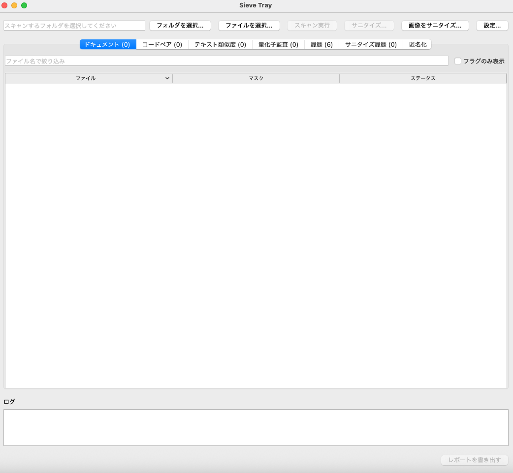
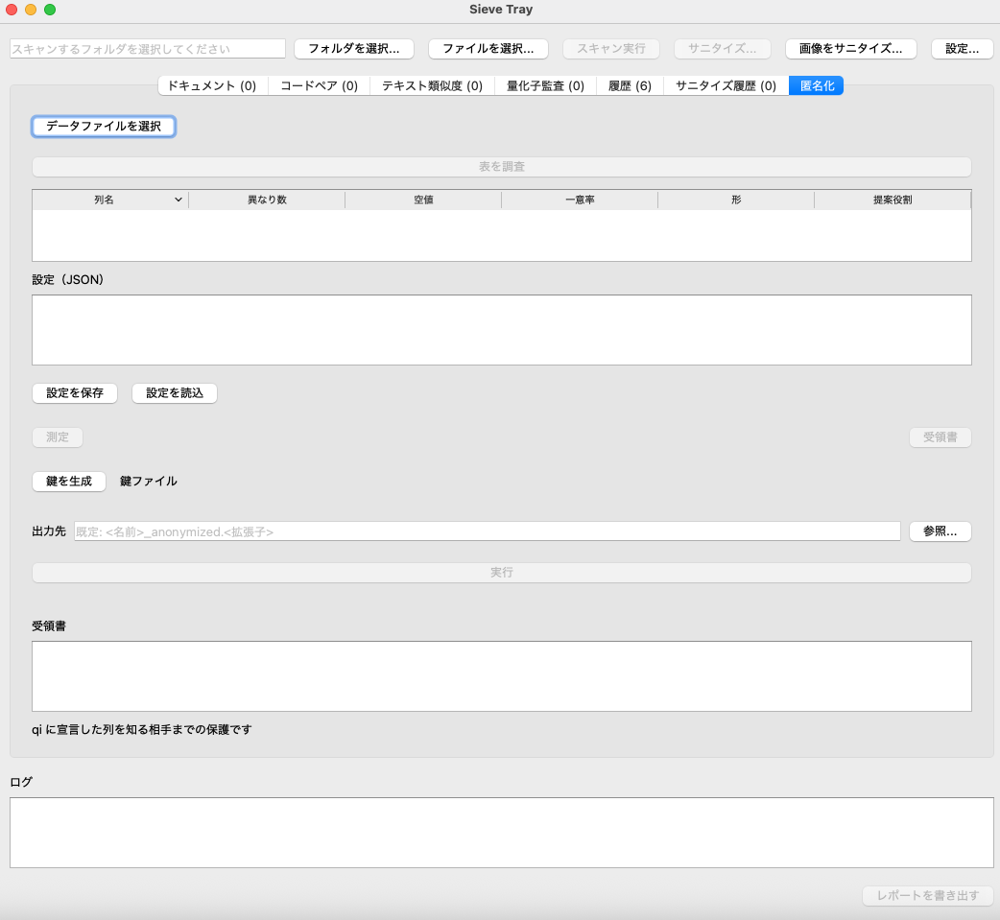
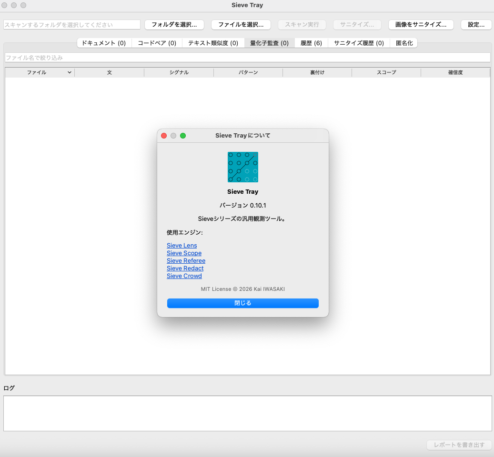
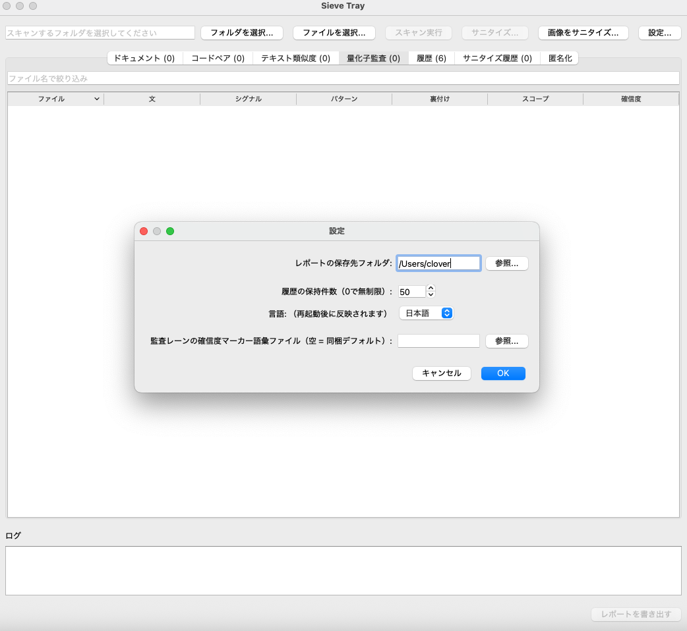

**English** | [日本語](README.ja.md)

# Sieve Tray v1.0.0

**A general-purpose observation tool — a desktop front-end for the Sieve series**

> Combines [Sieve Lens](https://github.com/neguseatama/sieve-lens)'s invisible-content
> observation, [Sieve Scope](https://github.com/neguseatama/sieve-scope)'s code
> similarity detection, and [Sieve Referee](https://github.com/neguseatama/sieve-referee)'s
> text paraphrase detection — plus, new in v0.8.0, Sieve Referee's quantifier
> audit lane — into a single desktop app. It also bundles
> [Sieve Redact](https://github.com/neguseatama/sieve-redact), the masking
> engine behind the text/image Sanitize actions, and — new in v0.10.0 —
> [Sieve Crowd](https://github.com/neguseatama/sieve-crowd), the table
> anonymization engine behind the Anonymize tab. Point it at a folder of
> submissions and it detects and reports, in one pass, documents containing
> invisible content or hidden prompts, code pairs with suspicious structural
> similarity, text pairs that look paraphrased or reused, and sentences that
> make ungrounded universal claims (hallucination candidates).

[](https://github.com/neguseatama/sieve-tray/actions/workflows/test.yml)
[](https://github.com/neguseatama/sieve-tray/actions/workflows/release.yml)
[](https://opensource.org/licenses/MIT)
[](https://www.python.org/)

---

## 💡 Concept

[Sieve Lens](https://github.com/neguseatama/sieve-lens) answers "does this
document contain something a human can't see but a parser can?".
[Sieve Scope](https://github.com/neguseatama/sieve-scope) answers "do these two
source files share suspiciously similar logic, beyond coincidence?".
[Sieve Referee](https://github.com/neguseatama/sieve-referee) answers "does
this text say the same thing as that one, just reworded?".
[Sieve Redact](https://github.com/neguseatama/sieve-redact) handles "hide
exactly the regions you chose, and prove nothing else changed".
[Sieve Crowd](https://github.com/neguseatama/sieve-crowd) handles "share this
table without exposing the individuals in it". All five are zero-dependency,
deterministic engines in the Sieve series — but checking a folder of
submissions by hand meant running separate tools and cross-referencing the
output yourself.

**Sieve Tray** removes that step. Point it at a directory containing one
subfolder per submission, and it automatically routes each file to the right
engine: documents go to Sieve Lens, `.py` files go to Sieve Scope's pairwise
comparison, and plain-text files (`.txt`/`.md`) additionally go to Sieve
Referee's pairwise paraphrase comparison **and** Sieve Referee's quantifier
audit lane (new in v0.8.0, powered by Sieve Referee >=1.3.0). Results land in
a single window, with local history so nothing has to be re-run, and a detail
view showing exactly which observation axis fired and why — never a bare
verdict, only what the underlying engines actually observed. The **Anonymize**
tab additionally puts Sieve Crowd one click away for table files, and the
Sanitize actions put Sieve Redact behind the text and image editors.

> Like the rest of the Sieve series, this is an **observation tool, not a
> judgment tool**. A flagged item means "this deserves a human look", not
> "this is confirmed misconduct".

---

## 🧩 The Sieve Series

Sieve is a family of deterministic, zero-dependency engines that share
the same design principles (deterministic output, no telemetry, fully
local) — each engine observes or treats one specific risk, and they
compose:

| Package | Role | Connects to |
|---------|------|-------------|
| [sieve-core-engine](https://github.com/neguseatama/sieve-core) | Deterministic structure aggregation & confidence scoring — the base engine of the ecosystem | — |
| [sieve-lens](https://github.com/neguseatama/sieve-lens) | Observes invisible content & hidden prompts in documents | → redact via `--from-lens`, → tray |
| [sieve-scope](https://github.com/neguseatama/sieve-scope) | Observes structural similarity between source files | → tray |
| [sieve-referee](https://github.com/neguseatama/sieve-referee) | Screens text structure, reuse, and paraphrase | → tray |
| [sieve-redact](https://github.com/neguseatama/sieve-redact) | Deterministic masking of chosen regions with change records & completeness verification | ← lens, → tray |
| [sieve-order](https://github.com/neguseatama/sieve-order) | Observes prompt surface structure in a 6-bit observation space and issues receipts | — |
| [sieve-crowd](https://github.com/neguseatama/sieve-crowd) | Anonymizes table data with deterministic math transforms | → tray |
| [sieve-tray](https://github.com/neguseatama/sieve-tray) | Local front-end that unifies the engines | ← all engines |

Observation → masking in one pass: Lens finds what a human can't see,
Redact removes it with a receipt that proves nothing else changed.

## 🔥 Key Features

- **One folder in, everything checked** — routes `.py` files to Sieve Scope,
  plain-text files (`.txt`, `.md`) additionally to Sieve Referee (both pairwise
  paraphrase comparison **and** the quantifier audit lane), and all
  documents (including `.html`, `.docx`, `.pdf`, images) to Sieve Lens,
  automatically, by extension.
- **Background-threaded GUI** — scanning never freezes the window, even on
  large submission sets.
- **English and Japanese UI** — switch languages from the Settings dialog
  (English by default). Note: Sieve Referee's own explanation text for a
  flagged text pair is generated in Japanese regardless of UI language,
  since the engine's calibration is Japanese-specific; the detail dialog
  shows it labeled as such.
- **Sortable, filterable results** — click any column to sort; filter
  documents by filename and/or "flagged only"; filter code/text pairs by
  filename.
- **Detail dialog** — double-click any row to see the per-axis observation
  states and the underlying evidence/scores/reason the engine recorded, not
  just the mask string.
- **Quantifier Audit lane (new in v0.8.0)** — every scanned `.txt`/`.md`
  file is also passed through Sieve Referee's quantifier audit lane, which
  flags sentences that make universal claims without backing (`theorem` /
  `enumerated` / `sample`) — the kind of "all X are Y" claim that, with no
  proof or finite enumeration behind it, is a hallucination candidate.
  Flagged sentences surface in their own **Quantifier Audit** tab, one row
  per sentence, with the signal (RED = unbacked universal, YELLOW =
  sample-only or unbacked measured), the matched patterns, and a separate
  **Certainty Markers** section in the detail dialog showing any epistemic
  certainty markers (e.g. 「明白に」「例外なく」) co-occurring in the sentence.
  The lane ships with a bundled default modifier-vocab file; users can
  override the path from Settings to swap in a custom vocabulary.
- **Local history** — every scan and anonymization run is saved to a
  local SQLite database
  (`~/.sieve_tray/history.db`); revisit a past run without re-scanning.
- **Configurable** — default export folder, history retention, UI language,
  and the audit lane's modifier-vocab file (empty = bundled default) are all
  adjustable from a Settings dialog.
- **File or folder selection (new in v0.9.0)** — point Sieve Tray
  at a whole folder (the original mode) or pick individual files; the
  audit lane runs on a single document, so file-selection mode is a
  natural fit for quick one-off checks.
- **Self-contained report export (HTML or Markdown)** — every result
  can be exported as a standalone HTML report, or as a Markdown report
  for plain-text / version-controlled workflows.
- **History clear (new in v0.9.0)** — the History and Sanitize History
  tabs each have a "Clear History" button for when you want to wipe the
  local SQLite store.
- **Improved signal colors (new in v0.9.0)** — RED and YELLOW rows
  have stronger pastel backgrounds and the signal column is rendered
  in a signal-colored foreground, so flagged rows are easy to spot at a
  glance even on calibrated monitors.
- **Sanitize text files** — run the bundled Sieve Redact engine over the
  selected folder's `.txt`/`.md` files with a rules file of your choice;
  every output gets a machine-readable receipt, and the summary always
  reports the masked item count and the byte-integrity verification.
- **Sanitize an image** — drag rectangles on a PNG (8-bit RGB/RGBA) in the
  region editor, preview the real engine output in place, and save a reusable
  region config; every output gets a machine-readable receipt (pixel integrity
  is verified; byte integrity is not applicable to PNG re-encoding).
- **Sanitize a folder of images** — apply one region config to every PNG
  (8-bit RGB/RGBA) in the folder. The config kind routes the run:
  region-only configs target PNGs, rule/builtin configs target
  `.txt`/`.md`, and files that don't match are reported as excluded
  (never as failures). A config mixing both kinds is rejected up front
  with nothing processed. Every output gets a machine-readable receipt.
- **Anonymize tables (new in v0.10.0)** — the **Anonymize** tab sends a
  table file (`.csv`/`.json`/`.xml`) to the bundled Sieve Crowd engine:
  inspect columns (distinct counts, unique ratios, suggested roles), dry-run
  the transform to compare before/after alone-row counts, generate a
  pseudonym key, and run deterministic anonymization with a
  machine-readable receipt (records in/out, suppressed count, k achieved,
  status). Protection is k-anonymity against an outsider who knows the
  declared quasi-identifiers; if the requested k is not achievable, the
  engine refuses without writing an output file. Every run is saved to the
  local history database and included in exported reports. The tab also
  keeps an 8-column run history view (latest 20 runs, refreshed at
  startup and after each run; new in v1.0.0).
- **Sanitize history tab** — every sanitize run (folder and single
  image) is listed in its own tab with timestamp, folder, config,
  output location, files and ok count, masked items, and integrity
  failures, and refreshes the moment a run completes.
- **Runs entirely on your machine** — scanning happens 100% locally. Submission
  contents never leave your device: no cloud upload, no API calls involved.
- **Zero-dependency core** — the scanning engine (`sieve_tray.py`) itself
  uses only the Python standard library plus Sieve Lens / Sieve Scope /
  Sieve Referee. The GUI is an optional layer (`PySide6`) on top, kept
  separate so the core stays consistent with the rest of the Sieve series'
  "zero dependency, offline, deterministic" design.
- **Cross-platform desktop builds** — CI produces standalone Windows and
  macOS (Apple Silicon + Intel) apps via PyInstaller; no Python installation
  required to run them.

---

## 📦 Installation

### Option 1: Download a pre-built app (recommended)

No Python required. Download the build for your platform from the
[Releases page](https://github.com/neguseatama/sieve-tray/releases):

| Platform | Asset |
|---|---|
| Windows | `SieveTray-windows.zip` |
| macOS (Apple Silicon / M-series) | `SieveTray-macos-arm64.zip` |
| macOS (Intel) | `SieveTray-macos-intel.zip` |

Unzip and run `SieveTray.exe` / `SieveTray.app`. On first launch, macOS will
warn that the developer can't be verified (the app isn't code-signed yet) —
go to **System Settings → Privacy & Security** and click **Open Anyway**.
Windows SmartScreen may show a similar warning; choose **More info → Run
anyway**.

### Option 2: Install from source

```bash
git clone https://github.com/neguseatama/sieve-tray.git
cd sieve-tray
python3 -m venv .venv && source .venv/bin/activate
pip install -e ".[gui]"
python3 sieve_tray_gui.py
```

Requires Python 3.10–3.13 (PySide6 does not yet support 3.14).

Core only, no GUI (for CLI usage or scripting):

```bash
pip install -e .
```

---

## 💻 Quick Start

### GUI

1. Launch the app.
2. Click **Select Folder...** and pick a directory containing one subfolder
   per submission.
3. Click **Run Scan**.
4. Browse results in the **Documents**, **Code Pairs**, **Text Similarity**,
   and **Quantifier Audit** tabs — sort by column, filter by filename, and
   double-click any row for the full per-axis breakdown (audit rows show a
   separate **Certainty Markers** section in the detail dialog).
5. Export a shareable report with **Export HTML Report**. Past runs are
   always available under the **History** tab.

(The interface language defaults to English; switch to Japanese from the
Settings dialog. Takes effect after restart.)

### CLI

```bash
python3 sieve_tray.py path/to/submissions -o report.html
```

Expects a directory of subdirectories, one per submission:

```
submissions/
    student_a/
        essay.docx
        solution.py
    student_b/
        essay.docx
        solution.py
```

### As a library

```python
from pathlib import Path
from sieve_tray import run_scan, render

result = run_scan(Path("submissions"), progress=print)
print(result.doc_results)   # path / mask / flagged / h_states / evidence
print(result.code_pairs)    # a / b / mask / h_states / scores
print(result.text_pairs)    # a / b / signal / mask / pattern_name / reason / h_states / scores
print(result.audit_results) # v0.8.0: file / sentence_sha256 / sentence_text /
                           #         patterns / backing / scope / signal /
                           #         pattern_name / reason / certainty_markers /
                           #         modifier_vocab_sha256 / modifier_vocab_count

Path("report.html").write_text(render(result))
```

---

## 🖼️ Screenshots

| Main window | Anonymize tab |
|---|---|
|  |  |

| About dialog | Settings dialog |
|---|---|
|  |  |

---

## 🔬 Testing

```bash
pip install -e . pytest
pytest -v
```

132 tests cover the core scan/render pipeline (including regression tests for
a CSS rendering bug and for Sieve Referee's paraphrase detection), the
history/settings storage layer (save / load / delete / retention pruning,
including migration from pre-Referee databases), and the i18n string tables
(English/Japanese key parity), plus the vendored Sieve Redact
integration (byte-pin sync and exit-code mapping), and the image
sanitize path (region helpers, receipt handling, and editor widgets
under an offscreen Qt platform), and the folder-uniform image
sanitize flow (config-kind routing, excluded-file reporting, and
tree-level config errors), and the bundled Sieve Crowd integration
(core wrapper, storage, UI widgets, report section, vendor pin sync,
and the About engine list).

CI runs this suite on every push (Python 3.12, on Ubuntu), and
builds Windows/macOS desktop apps on every version tag.

---

## ⚠️ Known Limitations

1. **Code comparison is Python-only.** `.py` is the only extension routed to
   Sieve Scope; other languages are treated as plain documents (or ignored)
   for now.
2. **Text-similarity comparison is plain-text only.** `.txt`/`.md` are
   routed to Sieve Referee; rich formats (`.docx`, `.pdf`) are not
   currently extracted to plain text for this comparison, even though
   Sieve Lens still observes them individually.
3. **Sieve Referee's `reason` text is Japanese-only,** regardless of UI
   language, since the engine's similarity thresholds are calibrated for
   Japanese text. The detail dialog surfaces it labeled as such.
4. **Desktop builds are not code-signed.** Windows SmartScreen and macOS
   Gatekeeper will warn on first launch; this is expected for an unsigned
   build.
5. **This is an observation tool, not a judgment tool** (inherited from
   Sieve Lens, Sieve Scope, and Sieve Referee). A flag means "a human should
   look at this", not "this is confirmed misconduct".
6. **Sanitize covers plain text and PNG images only** — the folder Sanitize
   action routes by config kind (region-only configs target PNGs,
   rule/builtin configs target `.txt`/`.md`) in a background thread; the
   image editor handles single PNGs (8-bit RGB/RGBA, non-interlaced). Both
   write a machine-readable receipt next to every output. PDF and JPEG
   masking are not supported by the bundled engine.
7. **Quantifier audit is Japanese-calibrated** (new in v0.8.0). The audit
   lane's default universal-scope vocabulary and modifier vocabulary are
   tuned for Japanese text; sentences in other languages may not trigger the
   lane even when they make equivalent universal claims. The lane surfaces
   the vocab sha256 and count in the detail dialog so the calibration is
   visible, and the modifier-vocab file can be overridden from Settings.
8. **Quantifier audit surfaces candidates, not verdicts.** A RED signal
   means "this sentence makes a universal claim with no backing recorded in
   the tagfile" — it is a hallucination *candidate*, not a confirmed
   hallucination. The tagfile is the source of truth for backing labels
   (`theorem` / `enumerated` / `sample` / `unbacked`); audit_text() does not
   populate the tagfile automatically. A human must confirm whether a
   flagged sentence is actually unbacked or merely un-tagged.
9. **Anonymization protects against the declared quasi-identifiers only**
   (new in v0.10.0). Sieve Crowd's k-anonymity guarantee holds against an
   outsider who knows exactly the columns declared as `qi`; columns you
   forget to declare are not protected. The declared qi, the achieved k,
   and the before/after alone-row counts are always surfaced, so the
   protection scope stays visible — and the engine refuses to write an
   output file when the requested k is not achievable.

---

## 📚 Related Projects

- [Sieve Core](https://github.com/neguseatama/sieve-core) — deterministic
  structure aggregation & confidence scoring base engine
- [Sieve Lens](https://github.com/neguseatama/sieve-lens) — invisible-content
  observation engine (documents)
- [Sieve Scope](https://github.com/neguseatama/sieve-scope) — code
  similarity detection engine
- [Sieve Referee](https://github.com/neguseatama/sieve-referee) — text
  paraphrase / plagiarism detection engine
- [Sieve Redact](https://github.com/neguseatama/sieve-redact) — deterministic
  masking with change records (text & PNG)
- [Sieve Order](https://github.com/neguseatama/sieve-order) — prompt surface
  structure observation engine (6-bit observation space)
- [Sieve Crowd](https://github.com/neguseatama/sieve-crowd) — table
  anonymization / privacy protection engine

---

## 🎨 Application Icon


Design: [AURA_HYSTERICA](http://www.maroon.dti.ne.jp/clover-hp/)

---

## 📄 License

MIT License. See [LICENSE](LICENSE) for details.

---

## 👤 Author

* **Kai IWASAKI**
